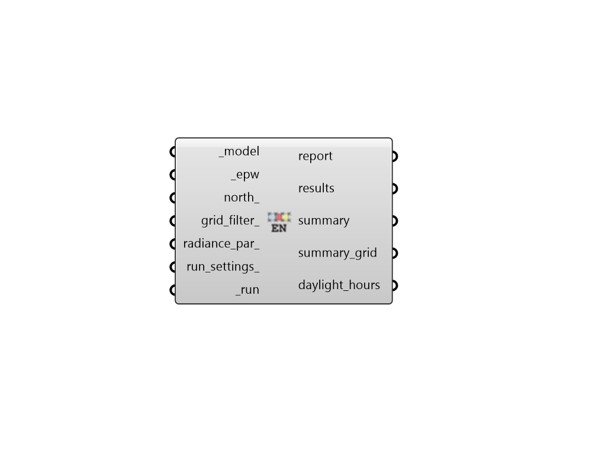

## Annual Daylight EN17037

 - [[source code]](https://github.com/ladybug-tools/honeybee-grasshopper-radiance/blob/master/honeybee_grasshopper_radiance/src//HB%20Annual%20Daylight%20EN17037.py)

Run an annual daylight compliance study according to European Standard EN 17037. 

This recipe executes a climate-based annual simulation using a 2-phase daylight  coefficient method. It automatically parses the input EPW or Wea to isolate the evaluation to unique, location-specific daylight hours.  

COMPLIANCE METRICS EVALUATED: * EN 17037 Metrics: Specifically gauges target illuminance thresholds across a      set percentage of the space for at least half of the daylight hours of the year. 

#### Inputs
* ##### model [Required]
A Honeybee Model for which Annual Daylight EN17037 will be simulated. Note that this model must have grids assigned to it. 
* ##### epw [Required]
An EPW or Wea object produced from the Wea components that are under the Light Sources tab. This can also be the path to a .wea or a .epw file. Note that the EPW and Wea must have a timestep of 1 to be used with this recipe. This input is used to create the "daylight hours" schedule. If an EPW is used, the schedule is based on global horizontal illuminance; if a Wea is used, it is based on global horizontal irradiance. 
* ##### north 
A number between -360 and 360 for the counterclockwise difference between the North and the positive Y-axis in degrees. This can also be Vector for the direction to North. (Default: 0). 
* ##### grid_filter 
Text for a grid identifer or a pattern to filter the sensor grids of the model that are simulated. For instance, first_floor_* will simulate only the sensor grids that have an identifier that starts with first_floor_. By default, all grids in the model will be simulated. 
* ##### radiance_par 
Text for the radiance parameters to be used for ray tracing. (Default: -ab 2 -ad 5000 -lw 2e-05). 
* ##### run_settings 
Settings from the "HB Recipe Settings" component that specify how the recipe should be run. This can also be a text string of recipe settings. 
* ##### run [Required]
Set to True to run the recipe and get results. This input can also be the integer "2" to run the recipe silently. 

#### Outputs
* ##### report
Reports, errors, warnings, execution logs, etc. 
* ##### results
Raw result files (.ill) that contain illuminance matrices for each sensor at each hour of the simulation. These can be postprocessed using various components under the 4::Results sub-tab. 
* ##### summary
A summary report of the whole model consisting of the sDA for "minimum illuminance" and "target illuminance". 
* ##### summary_grid
A summary report of each sensor grid consisting of the sDA for "minimum illuminance" and "target illuminance". 
* ##### daylight_hours
Occupancy schedule used in the post-processing. This schedule consists of the half of the year with the largest quantity of daylight. The schedule can be visualized with the 'Hourly Plot' component, or used in various components under the 4::Results sub-tab. 