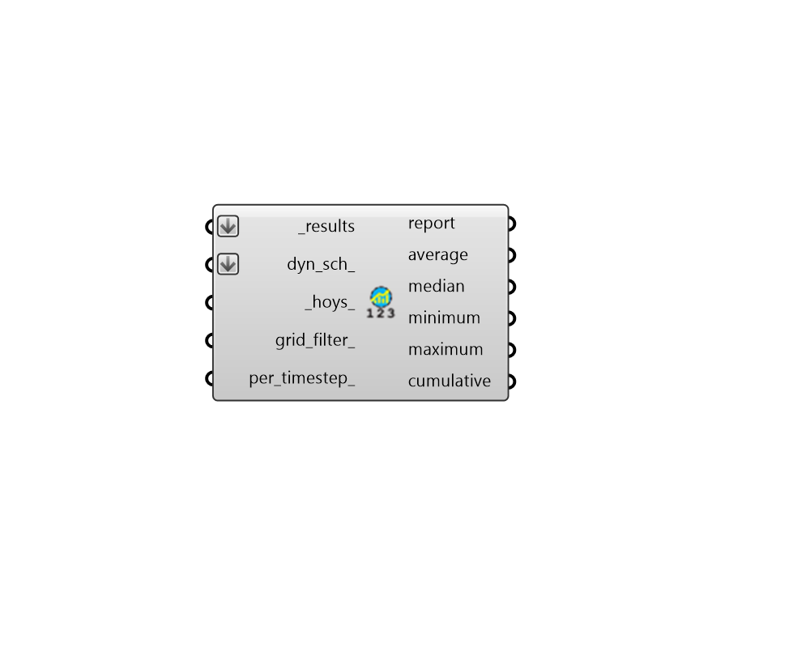
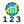

## Annual Statistics

 - [[source code]](https://github.com/ladybug-tools/honeybee-grasshopper-radiance/blob/master/honeybee_grasshopper_radiance/src//HB%20Annual%20Statistics.py)

Calculate typical statistics (Average, median, minimum, maximum, sum) for an annual daylight or irradiance simulation. Statistics can either be computed per sensor or per timestep. 

#### Inputs
* ##### results [Required]
An list of annual Radiance result files from the "HB Annual Daylight" component (containing the .ill files and the sun-up-hours.txt). This can also be just the path to the folder containing these result files. 
* ##### dyn_sch 
Optional dynamic Aperture Group Schedules from the "HB Aperture Group Schedule" component, which will be used to customize the behavior of any dyanmic aperture geometry in the output metrics. If unsupplied, all dynamic aperture groups will be in their default state in for the output metrics. 
* ##### hoys 
An optional numbers or list of numbers to select the hours of the year (HOYs) for which results will be computed. These HOYs can be obtained from the "LB Calculate HOY" or the "LB Analysis Period" components. If None, all hours of the results will be used. 
* ##### grid_filter 
The name of a grid or a pattern to filter the grids. For instance, first_floor_* will simulate only the sensor grids that have an identifier that starts with first_floor_. By default all the grids will be processed. 
* ##### per_timestep 
Set to True to calculate statistics per-timestep instead of per-sensor. 

#### Outputs
* ##### report
Reports, errors, warnings, etc. 
* ##### average
Average illuminance or irradiance values for each sensor or timestep in lux or W/m2. This is either a list of values or a list of data collections if per_timestep_ is True. 
* ##### median
Median illuminance or irradiance values for each sensor or timestep in lux or W/m2. This is either a list of values or a list of data collections if per_timestep_ is True. 
* ##### minimum
Minimum illuminance or irradiance values for each sensor or timestep in lux or W/m2. This is either a list of values or a list of data collections if per_timestep_ is True. 
* ##### maximum
Maximum illuminance or irradiance values for each sensor or timestep in lux or W/m2. This is either a list of values or a list of data collections if per_timestep_ is True. 
* ##### cumulative
Cumulative illuminance or irradiance values for each sensor or timestep in lux or W/m2. This is either a list of values or a list of data collections if per_timestep_ is True. 