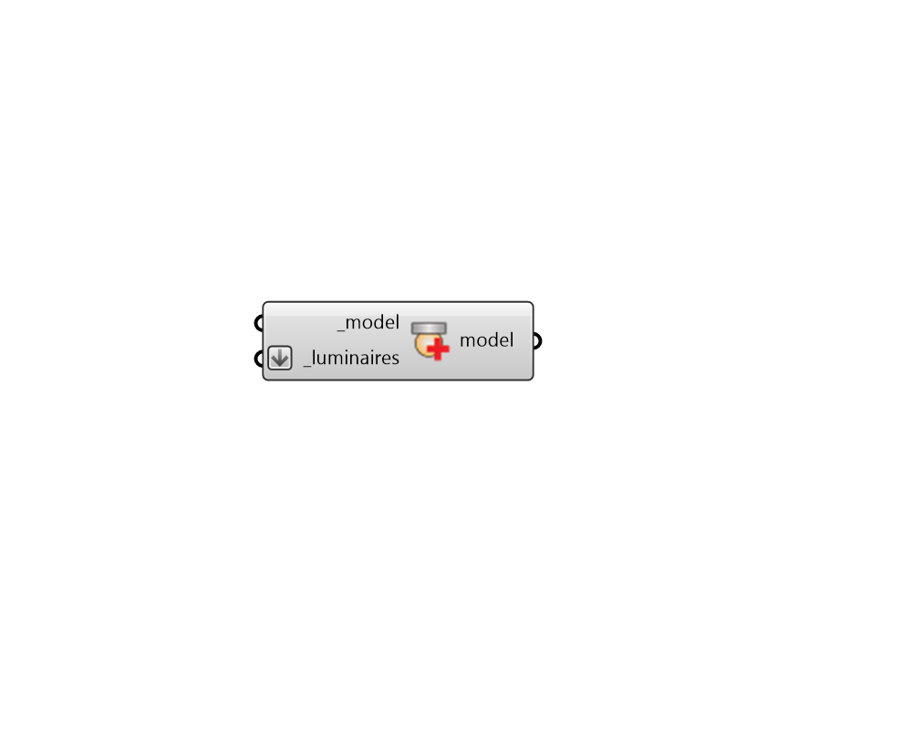

## Assign Luminaires

 - [[source code]](https://github.com/ladybug-tools/honeybee-grasshopper-radiance/blob/master/honeybee_grasshopper_radiance/src//HB%20Assign%20Luminaires.py)

Add Radiance Luminaires to a Honeybee Model. 

This assignment is necessary for any Radiance study, though whether a grid or a view is required for a particular type of study is depenednet upon the recipe used. 

Multiple copies of this component can be used in series and each will add the luminaires to any that already exist. 

#### Inputs
* ##### model [Required]
A Honeybee Model to which the input _luminaires will be assigned. 
* ##### luminaires [Required]
A list of Honeybee-Radiance Luminaires, which will be assigned to the input _model. 

#### Outputs
* ##### model
The input Honeybee Model with the luminaires assigned to it. 