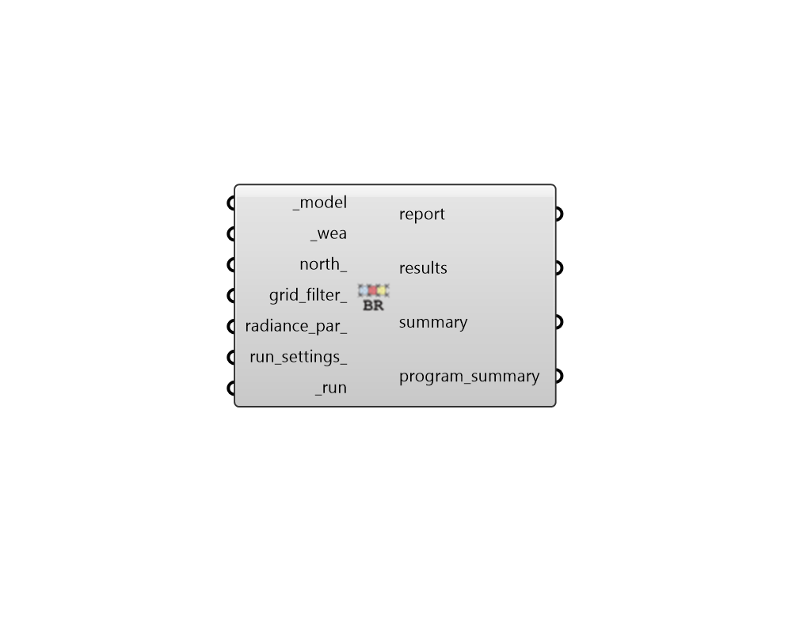

## BREEAM Daylight 4b

 - [[source code]](https://github.com/ladybug-tools/honeybee-grasshopper-radiance/blob/master/honeybee_grasshopper_radiance/src//HB%20BREEAM%20Daylight%204b.py)

Run a BREEAM Hea 01 (Path 4b) daylighting compliance study for a Honeybee model. 

This recipe executes a climate-based annual simulation using a 2-phase daylight  coefficient method to assess compliance against BREEAM daylighting criteria.  

SIMULATION REQUIREMENTS: * ROOMS: The model must consist of Honeybee Rooms. * PROGRAMS: The rooms must have Honeybee Energy programs assigned. Because BREEAM     maps distinct daylight targets depending on room function, this component outputs a program     breakdown by individual space type or program categories. The program is only used     to categorize the room type, and as such only the program name is important.     List of valid program names:     - BREEAM::Education_buildings::Preschools     - BREEAM::Education_buildings::Higher_education     - BREEAM::Healthcare_buildings::Staff_and_public_areas     - BREEAM::Healthcare_buildings::Patients_areas_and_consulting_rooms     - BREEAM::Multi_residential_buildings::Kitchen     - BREEAM::Multi_residential_buildings::Living_rooms_dining_rooms_studies     - BREEAM::Multi_residential_buildings::Non_residential_or_communal_spaces     - BREEAM::Retail_buildings::Sales_areas     - BREEAM::Retail_buildings::Other_occupied_areas     - BREEAM::Prison_buildings::Cells_and_custody_cells     - BREEAM::Prison_buildings::Internal_association_or_atrium     - BREEAM::Prison_buildings::Patient_care_spaces     - BREEAM::Prison_buildings::Teaching_lecture_and_seminar_spaces     - BREEAM::Office_buildings::Occupied_spaces     - BREEAM::Creche_buildings::Occupied_spaces     - BREEAM::Other_buildings::Occupied_spaces 

NOTE: If a room has no program assigned, BREEAM::Office_buildings::Occupied_spaces will be used as the default program. 

#### Inputs
* ##### model [Required]
A Honeybee Model for which BREEAM 4b will be simulated. Note that this model must have grids assigned to it. It is also required that the model consists of rooms and have HB-Energy programs assigned to them. 
* ##### wea [Required]
A Wea object produced from the Wea components that are under the Light Sources tab. This can also be the path to a .wea or a .epw file. Note that the Wea must have a timestep of 1 to be used with this recipe. 
* ##### north 
A number between -360 and 360 for the counterclockwise difference between the North and the positive Y-axis in degrees. This can also be Vector for the direction to North. (Default: 0). 
* ##### grid_filter 
Text for a grid identifer or a pattern to filter the sensor grids of the model that are simulated. For instance, first_floor_* will simulate only the sensor grids that have an identifier that starts with first_floor_. By default, all grids in the model will be simulated. 
* ##### radiance_par 
Text for the radiance parameters to be used for ray tracing. (Default: -ab 2 -ad 5000 -lw 2e-05). 
* ##### run_settings 
Settings from the "HB Recipe Settings" component that specify how the recipe should be run. This can also be a text string of recipe settings. 
* ##### run [Required]
Set to True to run the recipe and get results. This input can also be the integer "2" to run the recipe silently. 

#### Outputs
* ##### report
Reports, errors, warnings, execution logs, etc. 
* ##### results
Raw result files (.ill) that contain illuminance matrices for each sensor at each hour of the simulation. These can be postprocessed using various components under the 4::Results sub-tab. 
* ##### summary
A summary containing the number of BREEAM credits achieved  and a summary of the total area meeting the baseline criteria. This summary is organized per building type. 
* ##### program_summary
A detailed breakdown of compliance percentages organized by specific space and program types. 