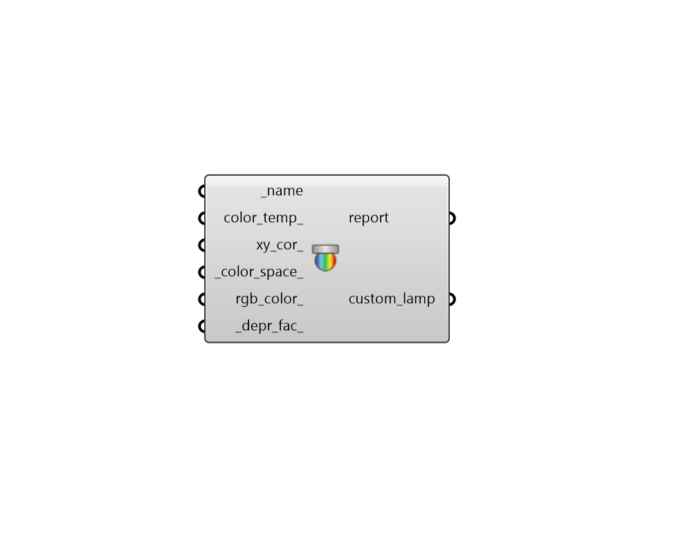

## Custom Lamp

 - [[source code]](https://github.com/ladybug-tools/honeybee-grasshopper-radiance/blob/master/honeybee_grasshopper_radiance/src//HB%20Custom%20Lamp.py)

Create a Honeybee CustomLamp. 

The CustomLamp can be used to set custom chromaticity, color or color temperature. If only the _name is set a default CustomLamp of 3200K is created, unless the name is a predefined lamp name. 

The priority of input is from the top. This means that if, e.g., both color_temp_ and xy_cor_ are set by the user, the color temperature have priority and the CustomLamp will be created from the color temperature. 

#### Inputs
* ##### name [Required]
Set the name of the custom lamp. If the name is among the predefined list of lamp names, the lamp name will override any values in the other inputs. 
The following lamp names are predefined. The values in parenthesis are the x, y 1931 chromaticity coordinates and lumen depreciation values: clear metal halide    (0.396, 0.39, 0.8) cool white            (0.376, 0.368, 0.85) cool white deluxe     (0.376, 0.368, 0.85) deluxe cool white     (0.376, 0.368, 0.85) deluxe warm white     (0.44, 0.403, 0.85) fluorescent           (0.376, 0.368, 0.85) halogen               (0.4234, 0.399, 1) incandescent          (0.453, 0.405, 0.95) mercury               (0.373, 0.415, 0.8) metal halide          (0.396, 0.39, 0.8) quartz                (0.424, 0.399, 1) sodium                (0.569, 0.421, 0.93) warm white            (0.44, 0.403, 0.85) warm white deluxe     (0.44, 0.403, 0.85) xenon                 (0.324, 0.324, 1) 
* ##### color_temp 
Set the color temperature in Kelvin for the lamp. This is used to calculate the chromaticity coordinates on the CIE 1931 xy diagram. Valid color temperature values are from 1000 to 25000. Will be ignored if the lamp name matches a predefined value. 
* ##### xy_cor 
Chromaticity coordinates for the lamp. This input must be a list of two values [x, y]. Will be ignored if color_temp_ is supplied. Or if the lamp name matches a predefined value. 
* ##### color_space 
Color space for the chromaticity coordinates. The values and their corresponding color spaces are 0 - CIE 1931 Color Space (default) 1 - CIE 1960 Color Space 2 - CIE 1976 Color Space 
* ##### rgb_color 
Specifiy the RGB color for the lamp. This can be a color from the "Colour Swatch" component or a text panel. Any alpha value of the color will be multiplied with the depreciation factor. Will be ignored if color_temp_ or xy_cor_ are supplied. Or if the lamp name matches a predefined value. 
* ##### depr_fac 
A scalar multiplier applied to account for lamp lumen depreciation. Must be greater than 0. Default: 1. 

#### Outputs
* ##### report
Reports, errors, warnings, etc. 
* ##### custom_lamp
A CustomLamp that can be plugged into a Luminaire. 