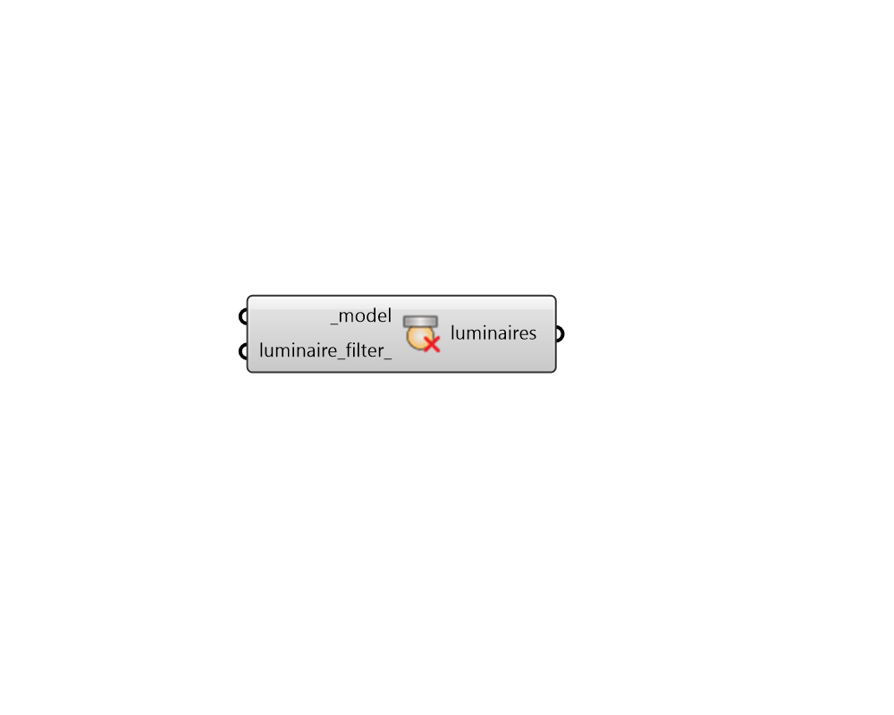

## Get Luminaires

 - [[source code]](https://github.com/ladybug-tools/honeybee-grasshopper-radiance/blob/master/honeybee_grasshopper_radiance/src//HB%20Get%20Luminaires.py)

Get Radiance Luminaires from a Honeybee Model. 

#### Inputs
* ##### model [Required]
A Honeybee Model for which luminaires will be output. 
* ##### luminaire_filter 
Script variable AssignLuminaires 

#### Outputs
* ##### luminaires
A list of Honeybee-Radiance Luminaires that are assigned to the input _model. 