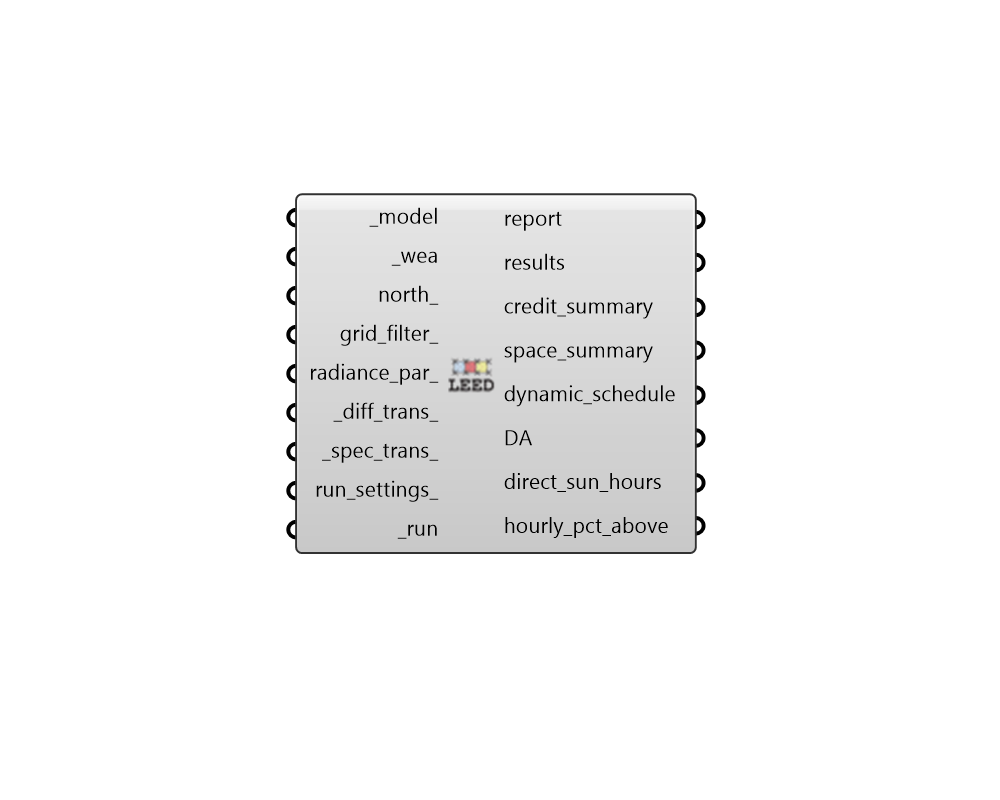

## LEED Option I

 - [[source code]](https://github.com/ladybug-tools/honeybee-grasshopper-radiance/blob/master/honeybee_grasshopper_radiance/src//HB%20LEED%20Option%20I.py)

Run a LEED v4.1 Daylight Option 1 daylight study for a Honeybee model. 

This recipe computes Spatial Daylight Autonomy (sDA) and Annual Sun Exposure (ASE)  in accordance with the IES LM-83-12 methodology required for LEED certification. It automates the multi-phase simulation required to model dynamic blinds/shades,  evaluating whether 2% or more of the room's sensors experience direct sunlight (>=1000 lux) for each hour of the year. The post-processing is using a 8AM-6PM occupancy schedule. 

SIMULATION REQUIREMENTS: * ROOMS: The model must consist of Honeybee Rooms. * APERTURE GROUPS: For dynamic shading to work, you must assign aperture groups      to your Honeybee Apertures through "HB Automatic Aperture Group" (room_based must     be True) or "HB Dynamic Aperture Group" for more control of the grouping. 

#### Inputs
* ##### model [Required]
A Honeybee Model for which LEED Option 1 will be simulated. Note that this model must have grids assigned to it. It is also required that the model consists of rooms and that aperture groups be assigned to exterior apertures. 
* ##### wea [Required]
A Wea object produced from the Wea components that are under the Light Sources tab. This can also be the path to a .wea or a .epw file. Note that the Wea must have a timestep of 1 to be used with this recipe. 
* ##### north 
A number between -360 and 360 for the counterclockwise difference between the North and the positive Y-axis in degrees. This can also be Vector for the direction to North. (Default: 0). 
* ##### grid_filter 
Text for a grid identifer or a pattern to filter the sensor grids of the model that are simulated. For instance, first_floor_* will simulate only the sensor grids that have an identifier that starts with first_floor_. By default, all grids in the model will be simulated. 
* ##### radiance_par 
Text for the radiance parameters to be used for ray tracing. (Default: -ab 2 -ad 5000 -lw 2e-05). 
* ##### diff_trans 
A fractional number between 0 and 1 representing the diffuse  visible transmittance of the dynamic blinds/shades when closed. 
* ##### spec_trans 
A fractional number between 0 and 1 representing the specular  visible transmittance of the dynamic blinds/shades when closed. 
* ##### run_settings 
Settings from the "HB Recipe Settings" component that specify how the recipe should be run. This can also be a text string of recipe settings. 
* ##### run [Required]
Set to True to run the recipe and get results. This input can also be the integer "2" to run the recipe silently. 

#### Outputs
* ##### report
Reports, errors, warnings, etc. 
* ##### results
Raw result files (.ill) that contain illuminance matrices for each sensor at each hour of the simulation. These can be postprocessed using various components under the 4::Results sub-tab. Note that these results are without dynamic shading. 
* ##### credit_summary
A summary detailing the total LEED points and overall model compliance statistics for sDA and ASE for the entire model. 
* ##### space_summary
A detailed room-by-room breakdown showing sDA, ASE, and floor area compliance for each individual space. 
* ##### dynamic_schedule
A list of Ladybug Data Collection, where each collection represents the dynamic schedule for an aperture group. The schedules can be visualized with the 'Hourly Plot' component. 
* ##### DA
Daylight Autonomy (DA) results in percent (0 to 100) for each sensor under the calculated dynamic blind schedules. 
* ##### direct_sun_hours
The number of occupied hours where each sensor receives direct solar illuminance above 1000 lux (used to compute ASE). 
* ##### hourly_pct_above
A list of Ladybug Data Collections, where each collection corresponds to a single sensor grid. The hourly values represent the percentage (%) of the grid's total floor area receiving direct sunlight illuminance above 1000 lux. The Data Collections can be visualized with the 'Hourly Plot' component. 