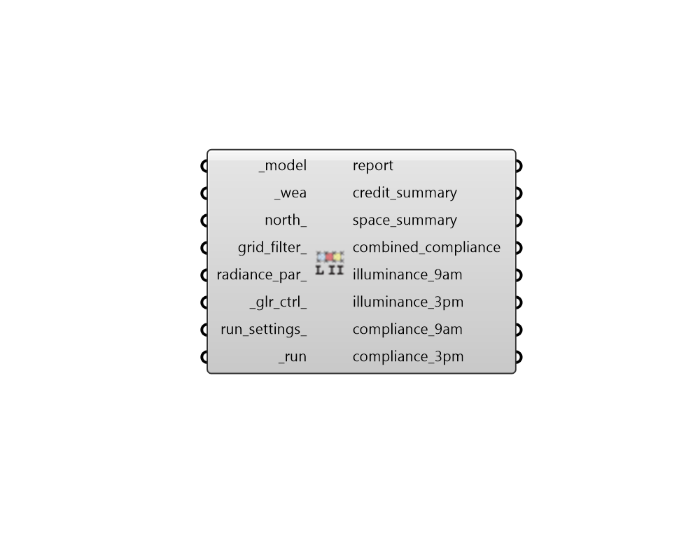

## LEED Option II

 - [[source code]](https://github.com/ladybug-tools/honeybee-grasshopper-radiance/blob/master/honeybee_grasshopper_radiance/src//HB%20LEED%20Option%20II.py)

Run a LEED v4.1 Daylight Option 2 point-in-time study for a Honeybee model. 

This recipe calculates illuminance for two specific times on a clear sky day  near the equinox: 9:00 AM and 3:00 PM. It determines compliance based on whether  sensor points fall within the target luxury range. 

GLARE CONTROL LOGIC: * If '_glr_ctrl_' is set to True, the space is assumed to possess view-preserving     automatic glare-control devices. Consequently, sensor points only need to     achieve an illuminance level above 300 lux to pass. * If '_glr_ctrl_' is set to False, sensor points must fall strictly between 300     lux and 3,000 lux to be considered compliant. 

#### Inputs
* ##### model [Required]
A Honeybee Model for which LEED Option II will be simulated. Note that this model must have grids assigned to it. 
* ##### wea [Required]
A Wea object produced from the Wea components that are under the Light Sources tab. This can also be the path to a .wea or a .epw file. Note that the Wea must have a timestep of 1 to be used with this recipe. 
* ##### north 
A number between -360 and 360 for the counterclockwise difference between the North and the positive Y-axis in degrees. This can also be Vector for the direction to North. (Default: 0). 
* ##### grid_filter 
Text for a grid identifer or a pattern to filter the sensor grids of the model that are simulated. For instance, first_floor_* will simulate only the sensor grids that have an identifier that starts with first_floor_. By default, all grids in the model will be simulated. 
* ##### radiance_par 
Text for the radiance parameters to be used for ray tracing. (Default: -ab 2 -ad 5000 -lw 2e-05). 
* ##### glr_ctrl 
Set to True to specify that the model has view-preserving automatic  (with manual override) glare-control devices. (Default: True). 
* ##### run_settings 
Settings from the "HB Recipe Settings" component that specify how the recipe should be run. This can also be a text string of recipe settings. 
* ##### run [Required]
Set to True to run the recipe and get results. This input can also be the integer "2" to run the recipe silently. 

#### Outputs
* ##### report
Reports, errors, warnings, etc. 
* ##### credit_summary
A summary containing the number of LEED credits achieved and  the percentage of the floor area that meets the criteria. 
* ##### space_summary
A detailed summary for each grid containing the percentage floor area each space that meets the compliance criteria. 
* ##### combined_compliance
Binary (1/0) for pass/fail evaluation results for both 9 AM and 3 PM. Points must pass at BOTH 9 AM and 3 PM. 
* ##### illuminance_9am
Illuminance (lux) values for the 9:00 AM simulation. 
* ##### illuminance_3pm
Illuminance (lux) values for the 3:00 PM simulation. 
* ##### compliance_9am
Binary (1/0) pass/fail evaluation results for the 9:00 AM simulation state. 
* ##### compliance_3pm
Binary (1/0) pass/fail evaluation results for the 3:00 PM simulation state. 