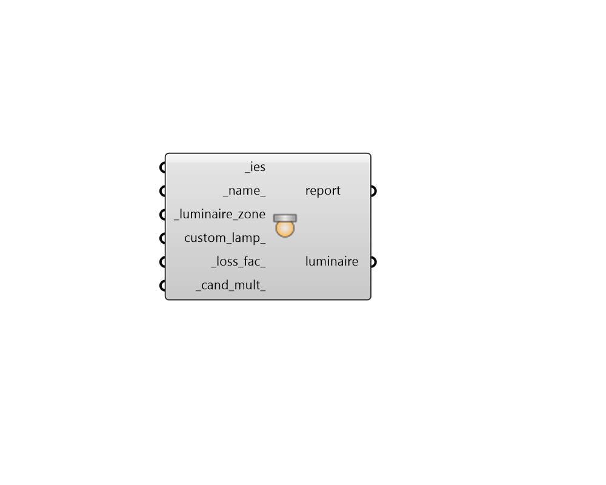

## Luminaire

 - [[source code]](https://github.com/ladybug-tools/honeybee-grasshopper-radiance/blob/master/honeybee_grasshopper_radiance/src//HB%20Luminaire.py)

Create a Honeybee Luminaire. 

The Luminaire object stores the photometric data of a light fixture and provides methods to:     - Parse IES LM-63 photometric data     - Generate Radiance geometry via ies2rad     - Generate photometric web geometry     - Place and orient luminaire instances in space via a LuminaireZone 

The Luminaire must be added to the Honeybee Model. The translation through ies2rad happens in the recipe. 

#### Inputs
* ##### ies [Required]
Path to an IES LM-63 photometric file or a string of the file contents. 
* ##### name 
Optional name of the luminaire. If None the IES file is used as the luminaire name. If the Honeybee Model includes multiple luminaires, each luminaire must have an unique name. 
* ##### luminaire_zone [Required]
A Honeybee LuminaireZone. The LuminaireZone specifices the location and rotation of the luminaire instances. 
* ##### custom_lamp 
A Honeybee CustomLamp. This can be used to specify custom chromaticity, color or color temperature. 
* ##### loss_fac 
A scalar multiplier applied to account for lamp lumen depreciation, dirt depreciation, or other system losses. Must be greater than 0 (default: 1). 
* ##### cand_mult 
Additional scalar multiplier applied to candela values after parsing the IES file. Must be greater than 0 (default: 1). 

#### Outputs
* ##### report
Reports, errors, warnings, etc. 
* ##### luminaire
A Honeybee Luminaire that can be used in a recipe. 