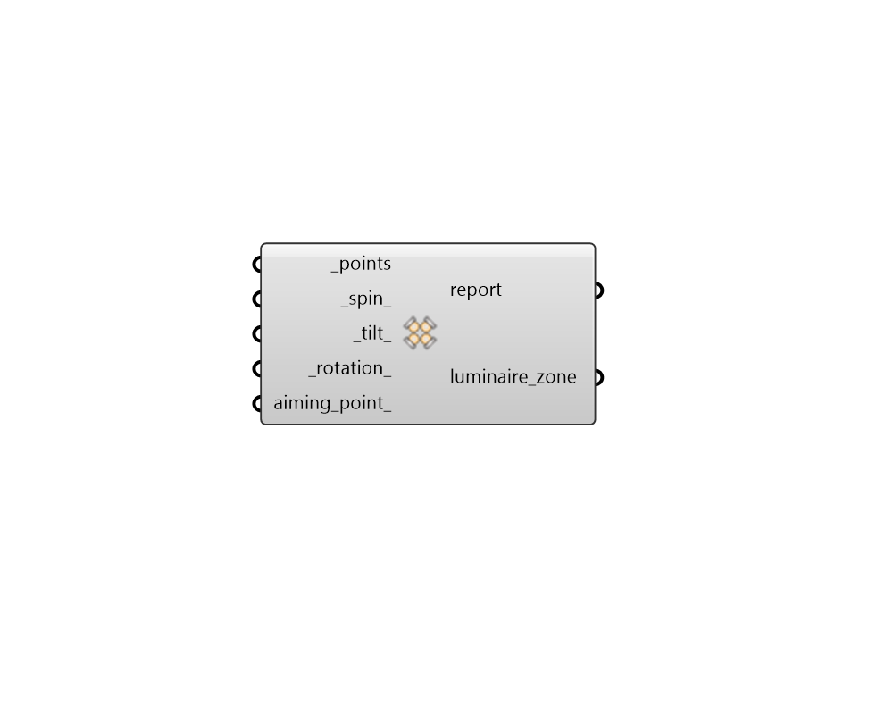

## Luminaire Zone

 - [[source code]](https://github.com/ladybug-tools/honeybee-grasshopper-radiance/blob/master/honeybee_grasshopper_radiance/src//HB%20Luminaire%20Zone.py)

Create a Honeybee LuminaireZone of LuminaireInstances. 

It is recommended to apply the rotation in the following order: spin, tilt, rotation. If an aiming point is added it will override any spin, tilt, and rotation values. 

#### Inputs
* ##### points [Required]
A point or list of points that will be used to position the luminaires. 
* ##### spin 
Rotation about the local vertical axis (degrees), This axis is also called the G0 axis. Default: 0. 
* ##### tilt 
Tilt angle around the Y axis (degrees). Default: 0. 
* ##### rotation 
Rotation angle around the Z axis (degrees). Default: 0. 
* ##### aiming_point 
A point representing the location at which the photometric axis of the luminaires should be aimed. This can also be a list of points that matches the length of _points. 

#### Outputs
* ##### report
Reports, errors, warnings, etc. 
* ##### luminaire_zone
A LuminaireZone that can be plugged into a Luminaire. 