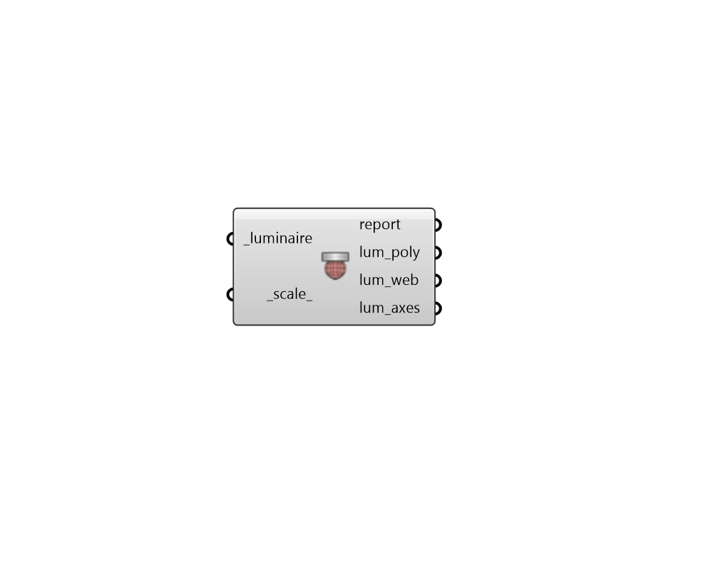

## Visualize Luminaire

 - [[source code]](https://github.com/ladybug-tools/honeybee-grasshopper-radiance/blob/master/honeybee_grasshopper_radiance/src//HB%20Visualize%20Luminaire.py)

Visualize a Luminaire. 

This is useful to check if the the spin, tilt, and rotation is applied correctly. 

#### Inputs
* ##### luminaire [Required]
A Honeybee Luminaire. 
* ##### scale 
A scalar value to scale the geometry. By default the geometry is normalized to Rhino model units as a base scale. The scalar value is multiplied with this base scale. 

#### Outputs
* ##### report
Reports, errors, warnings, etc. 
* ##### lum_poly
Geometric representation of the luminous opening. 
* ##### lum_web
Geometric representation of the candela distribution of the luminaire. 
* ##### lum_axes
Line representation of the C0-G0 axes of the luminaire. 