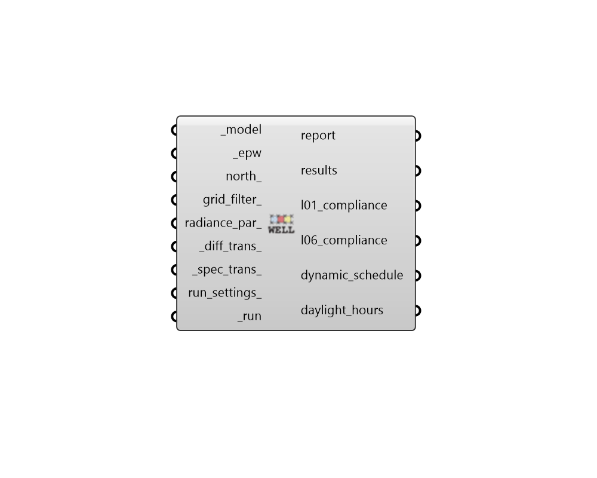

## WELL Daylight

 - [[source code]](https://github.com/ladybug-tools/honeybee-grasshopper-radiance/blob/master/honeybee_grasshopper_radiance/src//HB%20WELL%20Daylight.py)

Run a WELL v2 Daylight compliance study (Features L01 and L06) for a Honeybee model. 

This recipe executes an annual climate-based simulation using the 2-phase daylight  coefficient method. It automates the extraction of localized daylight hours directly  from an EPW file and processes automated aperture group blinds to verify both spatial  daylight access and dynamic glare control metrics. 

The component evaluates criteria for two primary features: * WELL Feature L01: Evaluates annual daylight via the IES LM-83 and EN 17037 methodology. * WELL Feature L06: Evaluates annual daylight via the IES LM-83 and EN 17037 methodology. 

SIMULATION REQUIREMENTS: * ROOMS: The model must consist of Honeybee Rooms. * APERTURE GROUPS: For dynamic shading to work, you must assign aperture groups      to your Honeybee Apertures through "HB Automatic Aperture Group" (room_based must     be True) or "HB Dynamic Aperture Group" for more control of the grouping. 

#### Inputs
* ##### model [Required]
A Honeybee Model for which WELL Daylight 4b will be simulated. Note that this model must have grids assigned to it. It is also required that the model consists of rooms and that aperture groups be assigned to exterior apertures. 
* ##### epw [Required]
An EPW or Wea object produced from the Wea components that are under the Light Sources tab. This can also be the path to a .wea or a .epw file. Note that the EPW and Wea must have a timestep of 1 to be used with this recipe. This input is used to create the "daylight hours" schedule; the daylight hours schedule is only used for the EN 17037 method. If an EPW is used, the schedule is based on global horizontal illuminance; if a Wea is used, it is based on global horizontal irradiance. 
* ##### north 
A number between -360 and 360 for the counterclockwise difference between the North and the positive Y-axis in degrees. This can also be a Vector for the direction to North. (Default: 0). 
* ##### grid_filter 
Text for a grid identifier or a pattern to filter the sensor grids of the model that are simulated. For instance, first_floor_* will simulate only the sensor grids that have an identifier that starts with first_floor_. By default, all grids in the model will be simulated. 
* ##### radiance_par 
Text for the radiance parameters to be used for ray tracing. (Default: -ab 2 -ad 5000 -lw 2e-05). 
* ##### diff_trans 
Diffuse visible transmission of the aperture group blinds when  deployed. (Default: 0.05 / 5%). 
* ##### spec_trans 
Specular visible transmission of the aperture group blinds when  deployed. (Default: 0.0001 / 0%). 
* ##### run_settings 
Settings from the "HB Recipe Settings" component that specify how the recipe should be run. This can also be a text string of recipe settings. 
* ##### run [Required]
Set to True to run the recipe and get results. This input can also be the integer "2" to run the recipe silently. 

#### Outputs
* ##### report
Reports, errors, warnings, execution logs, etc. 
* ##### results
A folder path containing the raw hourly illuminance matrix data tables  (`.ill`) generated for every sensor grid. 
* ##### l01_compliance
A summary of L01 compliance for both IES LM-83 and EN 17037. 
* ##### l06_compliance
A summary of L06 compliance for both IES LM-83 and EN 17037. 
* ##### dynamic_schedule
A list of Ladybug Data Collection, where each collection represents the dynamic schedule for an aperture group. The schedules can be visualized with the 'Hourly Plot' component. 
* ##### daylight_hours
Occupancy schedule used in the post-processing (for EN 17037). This schedule consists of the half of the year with the largest quantity of daylight. The schedule can be visualized with the 'Hourly Plot' component, or used in various components under the 4::Results sub-tab. 